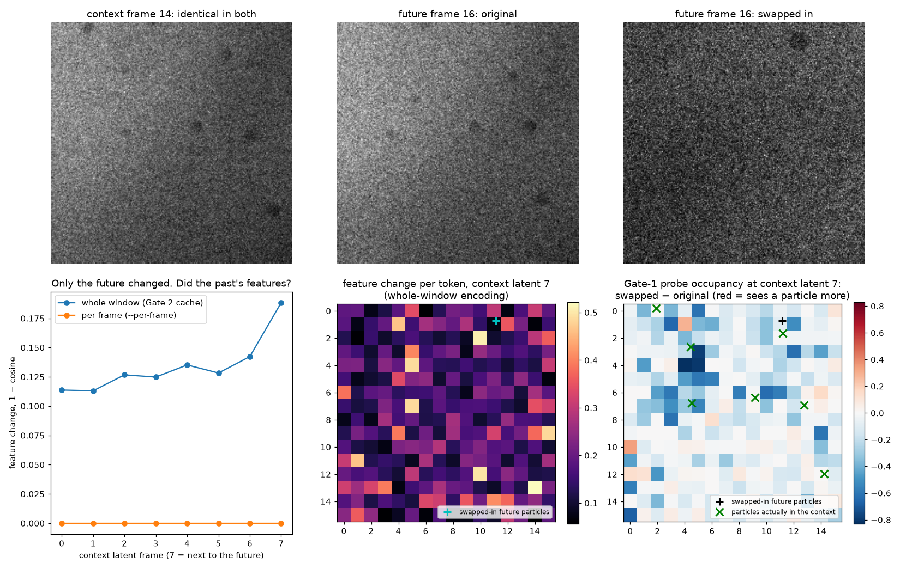

# Encoder look-ahead check

**Date:** 2026-10-01 · **Script:** `scripts/leak_check.py` (commit `960ff41`) · **Predictor:** predictor-v1 · **Data:** the 316 physics-stratum Gate-1 test windows · **Compute:** 1× RTX 3090.

## Question

The feature cache encodes each 64-frame window in a single pass, and the encoder attends
across all 64 frames. So the predictor's 8 context latents (frames 0–15) were computed
with the 48 future frames in view. Did that look-ahead drive the Gate-2 results?

## Method

Each window's 16 context frames are re-encoded **alone**, with no future in view
("causal"), and compared with the cached context. The test (from `PLAN.md`): if the +24
follow-up holds with the causal context, the look-ahead did not matter.

## Results

**(1) Token cosine, causal vs cached**, by context position. Position 7 is the frame next
to the forecast:

| pos | 0 | 1 | 2 | 3 | 4 | 5 | 6 | 7 |
|---|---|---|---|---|---|---|---|---|
| cos | 0.835 | 0.830 | 0.820 | 0.805 | 0.800 | 0.795 | 0.773 | 0.744 |

**(2) Probes on the context frames themselves, cached / causal:**
- Detection F1 is nearly unchanged: 0.77–0.84 cached vs 0.76–0.83 causal.
- Size distance is worse with the causal context, 1.75–1.91 → 2.11–2.45 px, worst at
  position 7.
- So causal features are still readable but somewhat off the distribution the probes were
  trained on.

**(3) The +24 follow-up with v1 started from the causal context**, compared with the
cached context (`experiments/core/README.md`):

| | cached context | causal context |
|---|---|---|
| F1 at +1, model / persistence (diffusion) | **0.80** / 0.55 | 0.54 / 0.56 |
| F1 at +5, model / persistence (diffusion) | **0.43** / 0.19 | 0.18 / 0.20 |
| size distance at +1, model / persistence (diffusion) | 1.56 / 1.64 | 2.68 / 1.68 |
| count at +24, model / floor (static) | 1.9 / 5.5 (fades) | 3.8 / 5.5 |
| peak occupancy at +24 (static) | 0.89 | 1.00 |
| mean radius at +24, model / floor (static) | 12.0 / 12.7 | 14.2 / 12.7 |
| exponent: diffusion / reaction / static | 0.218 / 0.414 / 0.006 | 0.376 / 0.548 / 0.105 |
| exponent: coalescence / ripening (floor 0.057 / 0.065) | −0.108 / 0.012 | 0.235 / 0.239 |
| size test at +24: diffusion / reaction | FAIL / untestable | "PASS" / "PASS" |

## Seeing it: swap only the future

`scripts/leak_figure.py` (smoke clips, 48-frame window) takes two versions of one window.
Their 16 context frames are identical pixel for pixel; from frame 16 on, one version
carries another clip's frames.

- **Whole-window encoding** (the Gate-2 cache): the *context* features change anyway,
  by 0.11–0.19 in 1 − cosine, growing toward the future.
- **The Gate-1 probe's reading of the last context frame changes too.** Its occupancy at
  the particles that are actually in that frame drops by up to 0.8: what the probe "sees"
  in the past depends on the future.
- **Per-frame encoding (`--per-frame`):** the change is exactly 0.

## Reading

1. **The look-ahead is real and large.**
   - The cached and causal features of the same frames agree at only 0.74–0.84 cosine.
     The closer a frame is to the future, the more the future changed it.
2. **v1's one clear positive result disappears without it.**
   - With the causal context, the model's detection F1 drops to persistence level at every
     horizon (0.54 vs 0.56 at +1).
   - The "drift carried forward" advantage reported in Gate 2 cannot be credited to learned
     dynamics.
3. **The model is also off-distribution on causal input.**
   - At +1 its size distance is far *worse* than persistence (2.68 vs 1.68). Simply copying
     the last frame would score better.
   - It was trained only on look-ahead contexts and is misled by honest ones.
   - So two causes are mixed and cannot be separated with v1:
     - it used future information;
     - honest contexts look unfamiliar to it.
4. **The two size "PASS"es are not credible, and are not a Gate-2 result.**
   - Once the causal frames slide out of its 8-frame context, v1 feeds only on its own
     forecasts. These settle into one generic sharp state in every process: count ~4,
     peak occupancy 1.00, radius 12–14 px.
   - That state happens to sit near the late-time size of the growth modes. It also gives
     *every* process spurious growth: static 0.105, coalescence and ripening 0.24 against
     a floor of ~0.06.
   - The diffusion and reaction exponents are inflated the same way. Forecasts start too
     small (diffusion radius 7.9 vs 9.2 px at +1) and end generic.
5. **Consequence, as fixed in `PLAN.md` before the run:**
   - The predictor must be retrained on contexts that never saw the future.
   - Until then, v1's Gate-2 numbers do not measure learned dynamics. This includes the
     FAIL, which stands as recorded but is not interpretable.
   - predictor-v2 trains on the same look-ahead cache, so it inherits the same flaw.

## Next

- **Re-extract the cache with `extract_features.py --per-frame`.** Each 2-frame tubelet is
  encoded alone, so no latent sees any other frame, as in V-JEPA 2-AC. The window layout is
  unchanged, so every downstream script runs as is.
- Then, in order:
  - Gate 1 on the per-frame features, to establish that they still carry the physics;
  - the predictor;
  - Gate 2 and the follow-up, unchanged.
- Step 11's readout encodes its predicted frames the same way.
